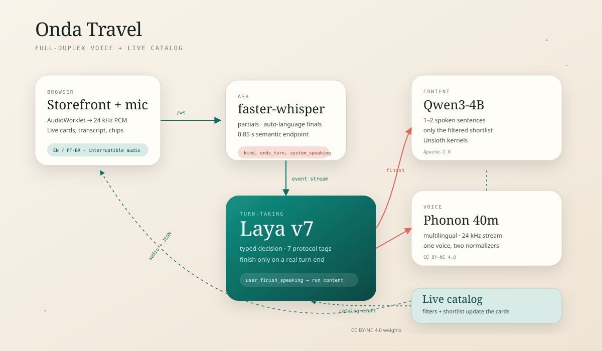

# Onda Travel — a bilingual full-duplex travel demo for Laya

This folder is a complete, self-contained example of the
[`laya_approach`](../README.md) companion doing real work in a product:

> A customer talks to **Laya**, the voice travel designer at **Onda Travel**.
> As they speak, Laya decides when the turn is really over, Qwen 3 4B turns the
> intent into a short spoken answer, and the website filters a mocked travel
> catalog in the same moment. The customer can interrupt mid-answer, and the
> conversation can switch between English and Brazilian Portuguese at any turn.

The page is a static storefront served by the same FastAPI process as the voice
loop. It has no external assets, so it also works on a laptop with no network
after the models are downloaded.



## What is wired together

| role | component | notes |
|---|---|---|
| turn-taking | **Laya v7** (`lumierenoir/laya-duplex-cascade-pt-br`) | decides `user_is_speaking` / `user_finish_speaking` / `user_interruption` / `user_backchannel` from the ASR stream |
| ASR | **faster-whisper** multilingual | incremental partials + auto-detected final, 24 kHz browser audio resampled to 16 kHz |
| content | **Qwen3-4B-Instruct-2507** | writes the 1–2 sentence spoken reply over the already-filtered shortlist |
| TTS | **Gradium Phonon 40m multilingual** (`ptts`) | streams 24 kHz float32 audio; `lang=pt` / `lang=en` normalizers |
| website | vanilla HTML/CSS/JS | live catalog, filter chips, transcript, telemetry, audio playback |

Laya never writes the answer. It answers one typed decision question per stream
event; only a fired `user_finish_speaking` starts Qwen. This is the same
`policy/laya_policy.py` runtime contract documented in the main README.

## Quick start

### 1. Environment

The main repository uses `.venv-unsloth` for Laya. Unsloth must be imported before
Transformers, and the policy needs `FastDecisionModel`, which is provided by
Unsloth **>= 2026.10.11**.

```bash
# from the repository root
python -m venv .venv-demo
source .venv-demo/bin/activate
# install the CUDA/ROCm torch build that matches your machine first, then:
pip install -r laya_approach/demo/requirements.txt
```

If you already have the repo's `.venv-unsloth` active, that is fine too:
`run_demo.sh` uses the active environment and only checks the app dependencies.

### 2. Download the models

```bash
# Laya v7 decision model (~1 GB)
hf download lumierenoir/laya-duplex-cascade-pt-br \
  --repo-type model --local-dir models/laya-companion

# Qwen 3 4B content model (~8 GB)
hf download Qwen/Qwen3-4B-Instruct-2507 \
  --local-dir models/qwen3-4b-instruct-2507

# Phonon multilingual checkpoint and one voice
hf download gradium/phonon-40m-multilingual \
  --local-dir models/phonon
hf download gradium/phonon-voices \
  voices.jsonl voices/KgC2Nqnjj48NUiyV.safetensors \
  --local-dir models/phonon-voices
```

`Manuela-Lu` (`KgC2Nqnjj48NUiyV`) is the default voice for both languages. It
speaks English with a slight Brazilian accent, which feels right for this
bilingual agent. Any other voice from
[`gradium/phonon-voices`](https://huggingface.co/gradium/phonon-voices) works:
download its `voices/<id>.safetensors` and pass `--tts-voice <name>`.

The Phonon 40m repositories are gated and CC BY-NC 4.0. Accept the terms on the
model page and run `hf auth login` once if the download asks for access.

### 3. Run

```bash
./laya_approach/demo/run_demo.sh
# or point at an existing environment:
PYTHON=/path/to/venv/bin/python ./laya_approach/demo/run_demo.sh
# or: python -m laya_approach.demo.server
# open http://localhost:7860
```

The first start loads Laya, Qwen, Whisper and Phonon (about 20–30 s on the
reference RTX 4080). The page shows a “waking Laya” pill meanwhile. The header's
bar-chart button opens the **Laya telemetry** panel: last tag, all seven
probabilities, latency, active Laya contract and model names.

For UI work without a GPU:

```bash
./laya_approach/demo/run_demo.sh --mock
```

`--mock` disables all models; the text box still exercises the deterministic
catalog and the bilingual fallback. The mic is disabled.

### Useful flags

| flag | effect |
|---|---|
| `--port 8080` | another port |
| `--mock` | text chat + deterministic filters, no models |
| `--no-llm` | deterministic bilingual replies, still voice |
| `--no-tts` | text UI + mic, no spoken output |
| `--no-stt` | typed chat only |
| `--no-policy` | no Laya checkpoint; heuristic turn taking |
| `--laya-stream audio` | use the v7 raw VAD contract instead of the semantic-final `text` contract |
| `--stt-model medium` | better ASR, more VRAM |
| `--tts-voice <name>` | Phonon catalog voice |
| `--endpoint-silence 0.85` | silence after speech before an ASR final |
| `--final-watchdog 1.5` | max wait for a Laya finish before the demo answers anyway |
| `--strict` | make a failed model load fatal instead of degrading to text/deterministic |

## A 90-second demo script

1. Click the orb and allow the microphone. The welcome is spoken first (the
   greeting text also has a small speaker button to replay it). Then say:
   > “I want a beach with good food under fifteen hundred dollars.”

   The ASR shows a partial (`I would like a beach…`) and Laya answers
   `user_is_speaking`, so nothing happens early. On the final it answers
   `user_finish_speaking`; Qwen replies and the collection narrows to Maragogi,
   Salvador and Tulum. The cards animate to the top picks.

2. While Laya is still speaking, interrupt:
   > “Actually, I changed my mind. I want mountains and a cozy romantic hotel.”

   The same microphone stream is still open. Laya sees the content with
   `system_speaking=True`, tags `user_interruption`, and the bridge stops the
   scheduled TTS immediately. The final turn is answered with Gramado.

3. Switch language mid-conversation:
   > “Quero trocar para português.” / “Switch to English.”

   The UI language, the next spoken reply and the TTS normalizer all switch.
   The active filters stay.

4. Ask something unrelated to travel:
   > “Who is Kenny Wallace?” / “Quem é Kenny Wallace?”

   Laya answers as a general assistant. The cards and filters stay exactly
   where they were. Try “Tell me a joke about the beach” or “What is the capital
   of France?” for more small talk.

5. Type `Tell me more about Gramado` in the composer. Typed and spoken turns
   share the same transcript and catalog state. Removing a filter chip on the
   cards is also a real interaction: the server applies the new filter set
   without asking the LLM.

6. Open **Laya telemetry**. You can see the v7 tag, the top probabilities, the
   latency and whether a watchdog had to rescue a turn. The terminal log shows
   the detected intent, language and reply for each turn.

## How the voice loop works

```
browser mic ──24 kHz f32 PCM──► /ws ──► StreamingASR (faster-whisper)
                                           │ partial / final
                                           ▼
                                  LayaPolicy.query(items)
                                           │ tag
                         ┌─────────────────┼──────────────────┐
                         │                 │                  │
                 user_is_speaking   user_finish_speaking  interruption
                    wait/telemetry   QwenTravelAgent        stop TTS
                                           │
                                  filters + shortlist
                                           │
                                  Qwen3-4B plain-text reply
                                           │
                               catalog event + TTS stream
                                           │
browser card reflow ◄── JSON ──────────────┘
```

### Why `stream="text"` is the default

The ASR endpoint is already a *semantic* end-of-turn: after 0.85 s of silence
the bridge emits one final event with `ends_turn=True`, and exposes the final
piece incrementally (no cumulative transcript repeated to Laya). That is exactly
the contract the text-trained stream expects. The v7 audio contract is designed
for raw VAD boundaries and uses deferred silence ticks; it is available with
`--laya-stream audio`, but its smooth-turn recall is lower, so the live demo
uses the semantic final and keeps the text contract.

In both cases the fix that motivates Laya is visible: **a partial that ends in
`.`, `?` or `!` never takes the floor**. You can watch the decision in telemetry
while the ASR placeholder is still updating.

### Travel conversation vs. small talk

Not every turn should move the catalog. The reply router classifies the turn
into four intents:

| intent | behavior |
|---|---|
| `travel` | apply the deterministic filters, show the filtered shortlist, answer from the catalog |
| `smalltalk` | answer with Qwen’s general prompt; **do not** change filters or cards |
| `mixed` | answer the general question and also update the travel shortlist |
| `language` | switch language without changing the active search |

Examples that now work without touching the page:

- “Who is Kenny Wallace?”
- “What is the capital of France?”
- “Tell me a joke about the beach.”
- “What’s the weather in Lisbon?” → Laya says she cannot check live weather.
- “Recommend a movie.”

Examples that still filter:

- “I want a beach with good food under $1,500.”
- “What trips do you have?”
- “Tell me more about Gramado.”
- “Quero uma viagem romântica na montanha.”

A mixed request such as “Who is Kenny Wallace? Also find me a beach trip”
answers the trivia question and updates the catalog in the same turn.

### What the server logs

Each turn now prints the full diagnostic trail, without logging audio bytes:

```text
[ed57013b] user (pt): 'Quem é Kenny Wallace?'
[ed57013b] policy user_finish_speaking (38 ms) event=final sys=False text='Kenny Wallace?'
[ed57013b] assistant intent=smalltalk lang=pt-BR catalog_changed=False fallback=False reply='...'
```

`intent`, detected language, policy tag/latency, whether the catalog changed
and the final reply make it possible to debug “why did Laya answer that?” from
the terminal.

### Welcome audio

Browsers block audio autoplay until the page receives a user gesture. The
greeting therefore plays on the first interaction:

- starting a voice session with the orb / “Start a voice session”;
- clicking the speaker icon inside the greeting bubble;
- or clicking elsewhere on the page once.

When a voice session starts, the microphone is opened immediately (to preserve
the browser gesture) but its PCM frames are suppressed until the welcome audio
finishes, so Laya does not transcribe her own greeting. Clicking the orb during
the welcome skips it and starts listening.

### Barge-in and backchannels

While the assistant is audible, every Laya event carries
`system_speaking=True`. A short acknowledgement (`aham`, `ok`, `yeah`) is
guarded as `user_backchannel` and does not cut the answer. New content is
`user_interruption`; the bridge sends `audio_control: stop`, cancels scheduled
WebAudio sources, invalidates the pending Qwen response and starts listening for
the new final. The browser asks for echo cancellation and noise suppression, but
the authoritative decision remains Laya's.

The final watchdog is a demo safety net, not part of the model: if the policy
has still not fired after 1.5 s of post-final silence, the bridge answers anyway
and marks `forced: true` in telemetry. With the text contract it rarely fires;
with `--laya-stream audio` it is more common.

### Language switching

* finals are always transcribed with language auto-detection;
* partials use the last known language as a decoding hint;
* a confident final-language detection switches the page **before** the answer
  is generated, so the conversation bubble, buttons, filter chips and cards
  re-localize while Laya is still thinking;
* typed turns use the bilingual word/diacritic detector in
  `travel_agent.detect_language`, and the reply's language is checked again
  before it reaches the UI and Phonon;
* the agent is prompted to answer in the language of the latest message and to
  switch when the customer switches;
* the reply's language drives both the UI (`language` event) and the Phonon
  normalizer (`pt` vs `en`).

Small talk also localizes the cards, but it does not change the active filters:
the server sends a localized copy of the current result set when only the
language changed.

This is why switching works even in the middle of a session, without reloading
the page.

## Layout

```
laya_approach/demo/
  server.py              FastAPI + websocket bridge, session state, barge-in
  audio.py               streaming ASR endpointing + Phonon TTS wrapper
  travel_agent.py        deterministic filters, bilingual fallback, Qwen reply
  travel_data.py         12 mock trips, tags, hooks for both languages
  smoke_demo.py          websocket smoke test (text or wav)
  run_demo.sh            launcher
  requirements.txt
  web/
    index.html           storefront
    styles.css           editorial layout, card scenes, responsive rules
    app.js               websocket protocol, transcript, filters, WebAudio
    audio-worklet.js     24 kHz PCM capture + resampling
    assets/favicon.svg
  tests/test_travel_agent.py
```

`docs/architecture.svg` is a static diagram generated for this README.

## Verification

```bash
# deterministic half: filters, languages, fallback, LLM prompt contract
python -m pytest laya_approach/demo/tests -q

# full text path against a running server (mock or real)
python -m laya_approach.demo.smoke_demo \
  --url ws://127.0.0.1:7860/ws \
  --text "I want a beach with good food under $1,500"

# microphone/STT path with a 24 kHz wav
python -m laya_approach.demo.smoke_demo \
  --url ws://127.0.0.1:7860/ws \
  --audio /path/to/24k_user.wav
```

The smoke test prints Laya's tags, the filtered catalog, the reply and the
generated audio duration.

## Troubleshooting

**The launcher picked the wrong Python / “missing demo dependencies”** — the
first line of `run_demo.sh` output is `[onda] python: …`. Point it at the GPU
environment explicitly:

```bash
PYTHON=/path/to/venv/bin/python ./laya_approach/demo/run_demo.sh
```

The launcher auto-detects `.venv-unsloth`, `.venv-demo` and `~/unsloth_uv` before
falling back to `python3`.

**“Server starts but the page stays on ‘Waking Laya’”** — open
`http://localhost:7860/api/health`. If a model fails, the server now starts in
degraded mode and lists the failure under `warnings`; the page also shows a
degraded-mode banner and keeps typed chat/filters working. Use `--strict` to
make the failure fatal and see the full traceback immediately. The most common
causes are a CUDA OOM (another process holding VRAM), a missing model directory,
or an Unsloth version older than 2026.10.11.

**`cannot import name 'FastDecisionModel' from 'unsloth'`** — the installed
Unsloth is too old. Upgrade to `>= 2026.10.11`; the decision model API landed
after the older 2026.9 releases. The server imports Unsloth before Transformers
on purpose.

**Phonon voice download fails / “No such file or directory”** — the voice file
was not downloaded. Either download `voices/Manuela-Lu`'s safetensors
(`KgC2Nqnjj48NUiyV`) into `models/phonon-voices/voices/`, or pass another voice
whose file exists. The demo uses the local `voices.jsonl`, so it does not need
network access at runtime.

**The microphone does not appear** — `getUserMedia` and `AudioWorklet` require a
secure context. Use `http://localhost:7860` or put the server behind HTTPS. A
plain LAN IP over HTTP will not capture.

**The welcome is silent** — browsers block autoplay until a gesture. Click the
speaker icon in the greeting bubble, start a voice session, or click once on the
page. Confirm the health endpoint reports `tts: true` and the browser tab is not
muted.

**The orb says “Listening” but no transcript appears** — if this tab was opened
before the worklet update, do one hard refresh (`Ctrl+Shift+R`, or
`Cmd+Shift+R` on macOS). The page version-busts `/audio-worklet.js?v=10`, but an
already-open tab keeps its old module. Then check that the browser has mic
permission and that the page is on `localhost`/HTTPS. In the server log, a
working session shows `user_partial`/`user_final` activity; silence there means
the browser is not sending PCM frames.

**Out of VRAM** — the reference load is about 11.5 GB: Qwen bf16 ~8 GB, Laya
~1.3 GB, Whisper small ~0.5 GB, Phonon on CPU. On a 12 GB card, run
`--no-llm` (deterministic replies) or use a smaller STT model. The demo does not
currently wire a 4-bit Qwen path.

**Slow first answer** — the first Laya call includes kernel warm-up and the
first Qwen generation includes graph setup (about 5–8 s on the reference host),
then turns settle at roughly 1.5–2.5 s for the LLM plus TTS start. The page
shows the thinking state; subsequent turns are much faster.

**It answers too eagerly / too late** — tune `--endpoint-silence` (ASR final)
and `--final-watchdog`. For the raw VAD contract, use `--laya-stream audio` and
expect the v7 deferred-confirmation trade-off described in the main README.

## Licenses

The demo code is part of this repository. The weights keep their own licenses:

* **Laya v7 checkpoint**: CC BY-NC 4.0 (base Laya Apache-2.0). See the model
  card and `laya_approach/COMMERCIAL.md` for the permissive retraining path.
* **Qwen3-4B-Instruct-2507**: Apache-2.0.
* **Phonon 40m multilingual**: CC BY-NC 4.0 (runtime `ptts` is MIT/Apache-2.0).
* **faster-whisper / Whisper**: MIT / Apache-2.0 model weights.

## Limitations

General conversation is generated by the local Qwen 3 4B model. It has no web
search, weather API or live news feed, and its factual knowledge can be
incomplete or out of date. The model is instructed to say when it is unsure,
but for anything important verify the answer. Travel recommendations stay
grounded in the mock catalog because that path receives only the filtered
shortlist.

All trips, prices and company details are fictional demo data. This is a
research/demo reference, not a commercial travel service.
